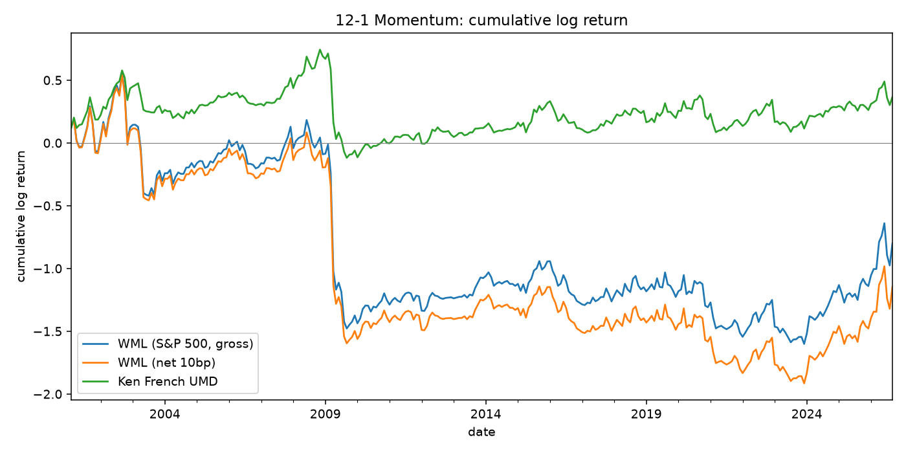
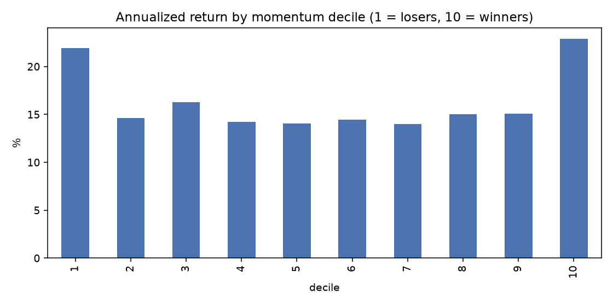
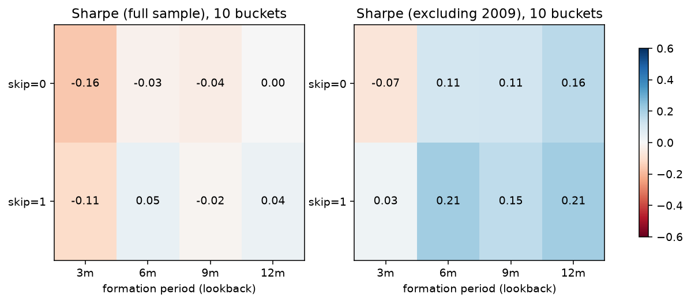

# 美股动量因子复现（Jegadeesh–Titman 12-1 Momentum）

用 Python 在美股（S&P 500 成分股）上复现经典的截面动量因子 **WML（Winners Minus Losers）**，并用 Ken French 数据库中的官方 **UMD** 因子做对照验证。

## 方法

| 项目 | 设定 |
|---|---|
| 股票池 | 当前 S&P 500 成分股（503 只，Wikipedia） |
| 数据 | yfinance 日度复权收盘价，2000-01 至今 → 月末价格 |
| 信号 | `mom_t = P_{t-1} / P_{t-12} − 1`（过去 12 个月收益，**跳过最近 1 个月**以规避短期反转） |
| 排序 | 每月末按信号截面分 10 组（每月至少 50 只有效股票） |
| 组合 | 组内等权，持有 1 个月，月度再平衡 |
| 因子 | WML = 第 10 组（赢家）− 第 1 组（输家） |
| 成本 | 按实际换手率扣除单边 10bp 交易成本（可调） |
| 基准 | Ken French `UMD`（全市场 CRSP、市值加权 2×3 排序） |
| 检验 | 相关系数、`WML ~ UMD` 与 `WML ~ FF3` 回归（Newey-West t 值） |

时间对齐（无前视偏差）：t 月末仅用 t−1 及更早的价格生成信号，在 t 月末建仓，收益记在 t+1 月。`tests/` 中有单元测试专门验证这一点（篡改 t 月及以后价格，t 月信号不变）。

## 结果（2001-02 ~ 2026-09，308 个月）



| | WML（毛） | WML（扣 10bp） | French UMD | Mkt-RF |
|---|---:|---:|---:|---:|
| 年化收益 | 0.95% | −0.38% | 2.83% | 8.32% |
| 年化波动 | 26.8% | 26.8% | 16.3% | 15.5% |
| Sharpe | 0.04 | −0.01 | 0.17 | 0.54 |
| 最大回撤 | −88.5% | −91.4% | −57.8% | −51.4% |
| 最差单月 | −54.3%（2009-04） | | −34.4%（2009-04） | |
| 偏度 | −1.66 | | −1.68 | |

**复现质量：与 French UMD 的相关系数为 0.91**，`WML ~ UMD` 回归 β = 1.50（t = 22.5），R² = 0.83，alpha 不显著。也就是说，用 S&P 500 + 免费数据构造的因子，在时序上基本还原了学术版本的动量因子；β ≈ 1.5 是因为我们用十分位极端组、等权，而 UMD 用三分位、市值加权，风险暴露更"稀释"。

分时段年化收益：

| 区间 | 本项目 WML | French UMD |
|---|---:|---:|
| 2001–2008 | 3.9% | 10.2% |
| 2009（动量崩溃） | −97.3% | −64.7% |
| 2010–2019 | 2.6% | 3.2% |
| 2020–2026 | 5.8% | 3.7% |

十分位收益：



## 稳健性检验

`python robustness.py` 在同一样本区间（2001-02 ~ 2026-09）上遍历 24 组参数：形成期 3/6/9/12 个月 × 是否跳过最近 1 个月 × 3/5/10 组。完整结果见 [`results/robustness_grid.csv`](results/robustness_grid.csv)。



**1. 形成期越长越好，3 个月动量在所有设定下都为负。**（10 组、跳过最近 1 个月）

| 形成期 | 年化收益 | Sharpe | 剔除 2009 年化 | 剔除 2009 Sharpe | 与 UMD 相关 | 月换手 |
|---|---:|---:|---:|---:|---:|---:|
| 3 个月 | −2.3% | −0.11 | 0.5% | 0.03 | 0.60 | 126% |
| 6 个月 | 1.1% | 0.05 | 4.5% | 0.21 | 0.74 | 82% |
| 9 个月 | −0.5% | −0.02 | 3.6% | 0.15 | 0.84 | 66% |
| 12 个月 | 1.0% | 0.04 | 4.9% | 0.21 | 0.91 | 56% |

短形成期信号更"噪"、换手翻倍，而且混入了 1 个月短期反转效应，所以表现最差。

**2. 跳过最近 1 个月有帮助。** 对 6/9/12 个月，`skip=1` 的 Sharpe 普遍高于 `skip=0`（剔除 2009 后差异更明显），与 Jegadeesh (1990) 的短期反转效应一致。

**3. 分组数影响不大。** 3/5/10 组的 Sharpe 排序基本一致；组数越少，回撤越小（12-1：三分位 −65% vs 十分位 −89%），因为极端组更容易在反弹中被挤压。

**4. 2009 年是关键。** 24 组参数中，全样本 Sharpe 最高也只有 0.05；剔除 2009 年后，除 3 个月形成期外几乎全部为正（最高 0.21）。但即使剔除 2009，本项目最好的设定 t 值也只有约 1，统计上仍不显著；作为对照，French UMD 剔除 2009 后年化 5.6%、Sharpe 0.39、t ≈ 1.9。

**5. 交易成本：盈亏平衡点约为单边 7bp。**（12-1、10 组）

| 单边成本 | 0bp | 5bp | 10bp | 20bp | 50bp |
|---|---:|---:|---:|---:|---:|
| 年化收益 | 1.0% | 0.3% | −0.4% | −1.7% | −5.7% |
| Sharpe | 0.04 | 0.01 | −0.01 | −0.06 | −0.21 |

**未做的检验**：市值加权（yfinance 没有历史流通股本，无法得到历史市值）、point-in-time 成分股（需 CRSP）。

## 结论与讨论

1. **因子复现成功，但动量在 2000 年后很弱。** 即使是官方 UMD，2001 年以来年化也只有 ~2.8%、t 值 0.88，不显著——这与文献中"动量溢价在近二十年显著衰减"的结论一致。
2. **动量崩溃（Momentum Crash）。** 2009 年 3–4 月市场急速反弹，前期跌得最惨的金融/周期股（输家）暴涨，空头腿巨亏，单月 −54%。这正是 Daniel & Moskowitz (2016) 描述的现象：熊市后的反弹期，动量呈强烈负偏。剔除 2009 年后，WML 每个阶段都是正的。
3. **输家组收益异常高（U 形而非单调）——幸存者偏差。** 用"今天的" S&P 500 成分股回测，意味着历史上的输家组只包含那些**后来恢复并留在指数里**的公司；真正破产/被剔除的输家不在样本内。这系统性地抬高了输家组收益、压低了 WML。这也是本项目 WML 弱于 UMD 的主要原因之一。
4. **交易成本不可忽略。** 多空两腿月均换手率约 56%，仅 10bp 的单边成本就把年化收益吃掉约 1.3 个百分点。

## 局限 & 可改进方向

- **幸存者偏差**：应使用历史时点成分股（point-in-time constituents）及退市收益，例如 CRSP / WRDS。
- **股票池偏大盘**：S&P 500 只覆盖大盘股，而动量在小盘股中更强。
- 可尝试：市值加权、波动率缩放动量（Barroso & Santa-Clara 2015）、残差动量、行业中性化。

## 运行

```bash
python -m venv .venv && source .venv/bin/activate
pip install -r requirements.txt
pytest -q          # 单元测试（无需联网）
python run.py      # 下载数据并回测，结果写入 results/
python run.py --start 1995-01-01 --cost-bps 20 --buckets 5   # 自定义参数
python robustness.py   # 参数网格 + 成本敏感性
```

首次运行会下载约 500 只股票 25 年的数据并缓存到 `data/`（已 gitignore）。

## 项目结构

```
momentum/
  data.py       # S&P 500 列表、yfinance 价格、Ken French 因子下载与解析
  factor.py     # 信号、分组、组合收益、换手率、WML 构建
  analysis.py   # 绩效统计、Newey-West 回归
run.py          # 主程序：回测 + 对比 + 作图
robustness.py   # 稳健性检验：形成期 / skip / 分组数 / 交易成本
tests/          # 前视偏差 / 分组 / 收益对齐 / 已知动量恢复 测试
results/        # 输出图表与 CSV
```

## 参考文献

- Jegadeesh, N., & Titman, S. (1993). Returns to Buying Winners and Selling Losers. *Journal of Finance*.
- Carhart, M. (1997). On Persistence in Mutual Fund Performance. *Journal of Finance*.
- Daniel, K., & Moskowitz, T. (2016). Momentum Crashes. *Journal of Financial Economics*.
- Barroso, P., & Santa-Clara, P. (2015). Momentum Has Its Moments. *Journal of Financial Economics*.
- Kenneth R. French Data Library.
